# PowerPoint 図の設計メモ

レポート用のオリジナル図を PowerPoint で描くための下書き。
図中の文字は英語（レポートに合わせる）、説明は日本語。
色の約束：**古典処理 = 青**、**量子処理 = 紫**、**白サブピクセル / 位相 π = オレンジ**。

---

## 図① 全体の流れ（pipeline）

横長 1 枚（レポートでは 2 段ぶち抜きの figure*）。上段が古典、中段が量子、下段が古典。

```mermaid
flowchart LR
    subgraph C1["Classical (blue)"]
        A["Photo<br/>408×530 RGB"] --> B["Crop + resize<br/>512×512"]
        B --> C["Greyscale"]
        C --> D["4×4 Bayer dithering<br/>→ 0/1 bitmap"]
        D --> E["Split into tiles<br/>128×128 tiles of 4×4"]
        E --> F["Loop over tiles<br/>(tile i, j)"]
    end

    subgraph Q["Quantum, one circuit per tile (purple)"]
        G["H gates<br/>blank canvas |s⟩"] --> H["Controlled Grover<br/>Q^1, Q^2, Q^4, Q^8<br/>(oracle O_f + mirror)"]
        H --> I["Inverse QFT<br/>on counter"]
        I --> J["Measure once<br/>readout y"]
    end

    subgraph C2["Classical (blue)"]
        K["Lookup table<br/>P(y | k)"] --> L["Most likely k̂"]
        L --> M["Brightness k̂/16<br/>= 1 output pixel"]
        M --> N["128×128 image"]
    end

    F -- "16 bits of the tile<br/>→ gates of O_f" --> G
    J --> K
    M -. "next tile" .-> F
```



描くときのポイント

- **F → G の矢印に「16 bits → gates」と書く**：写真が回路に入る唯一の場所なので、ここを強調する（太矢印・オレンジ）。
- 量子ブロックの右上に小さく「8 qubits (t = 4) × 16,384 circuits」と書く。
- 下に点線の枝で「Monte Carlo: n = 15 random subpixels → comparison」を足すと、比較実験も 1 枚で示せる。
- カラー版は「R, G, B で 3 回繰り返す」と吹き出しで添える程度でよい。

---

## 図② 写真がゲートになる（tile → gates）

レポートの例と同じタイル（row 35, column 64、白 8 個の市松模様）を使う。左から右へ 4 列。

**列 1：4×4 タイル**（白マス = オレンジ）

```
        qx=0  qx=1  qx=2  qx=3
qy=0  [ ■ ]  [   ]  [ ■ ]  [   ]
qy=1  [   ]  [ ■ ]  [   ]  [ ■ ]
qy=2  [ ■ ]  [   ]  [ ■ ]  [   ]
qy=3  [   ]  [ ■ ]  [   ]  [ ■ ]
```

**列 2：番号 x = 4·qy + qx**

```
 0   1   2   3
 4   5   6   7
 8   9  10  11
12  13  14  15
```

白は x = 0, 2, 5, 7, 8, 10, 13, 15 の 8 個。

**列 3：2 進数（pos3 pos2 pos1 pos0）と X をかける qubit**

| x | binary | X をかける qubit（bit = 0） |
|---|---|---|
| 0 | 0000 | pos0, pos1, pos2, pos3 |
| 2 | 0010 | pos0, pos2, pos3 |
| 5 | 0101 | pos1, pos3 |
| 7 | 0111 | pos3 |
| 8 | 1000 | pos0, pos1, pos2 |
| 10 | 1010 | pos0, pos2 |
| 13 | 1101 | pos1 |
| 15 | 1111 | （なし） |

**列 4：ゲート 1 組**（x = 5 を例に大きく描く）

```
pos0 ──────●──────
pos1 ──X───●───X──
pos2 ──────●──────
pos3 ──X───Z───X──
```

→ 「|0101⟩ の符号だけ反転」と注記。

描くときのポイント

- 列 1 の白マス 8 個から、列 4 のゲート 8 組へ**同じ色の線**を引く → 「白 1 個 = ゲート 1 組」が一目で分かる。
- 最後に結果の状態 $\frac14\sum_x (-1)^{f(x)}|x\rangle$ を書き、レポートの Fig. 2（円の図）と同じ並びで符号 + / − を示す。
- 下に一言：「The image is not loaded as data; it is compiled into the gate list.」

---

## 図③ 文字盤の図（なぜ t = 4 では 9 段階しか出ないか）

円を 16 等分（y = 0〜15）。**y = 0 を真上**、時計回りに 1, 2, …。y = 8 が真下。

**目盛りと復号結果**（各目盛りの外側に、その y で出力される k̂ を書く）

| y | 0 | 1 | 2 | 3 | 4 | 5 | 6 | 7 | 8 | 9 | 10 | 11 | 12 | 13 | 14 | 15 |
|---|---|---|---|---|---|---|---|---|---|---|---|---|---|---|---|---|
| k̂ | 16 | 15 | 14 | 11 | 8 | 5 | 2 | 1 | 0 | 1 | 2 | 5 | 8 | 11 | 14 | 15 |

→ 出てくる k̂ は {0, 1, 2, 5, 8, 11, 14, 15, 16} の **9 種類だけ**。

**各 k のピーク位置**（円の内側に点を打つ。1 つの k につき左右 2 点）

| k | y (右側) | y (左側) |
|---|---|---|
| 0 | 8.0 | 8.0 |
| 1 | 9.3 | 6.7 |
| 2 | 9.8 | 6.2 |
| 3 | 10.3 | 5.7 |
| 4 | 10.7 | 5.3 |
| 5 | 11.0 | 5.0 |
| 6 | 11.4 | 4.6 |
| 7 | 11.7 | 4.3 |
| 8 | 12.0 | 4.0 |
| 9 | 12.3 | 3.7 |
| 10 | 12.6 | 3.4 |
| 11 | 13.0 | 3.0 |
| 12 | 13.3 | 2.7 |
| 13 | 13.7 | 2.3 |
| 14 | 14.2 | 1.8 |
| 15 | 14.7 | 1.3 |
| 16 | 0 (=16) | 0 |

（式：$y = 16\left(\tfrac12 \pm \tfrac{1}{\pi}\arcsin\sqrt{k/16}\right)$）

描くときのポイント

- **縦の鏡の線**（y = 0 と y = 8 を結ぶ）を点線で引き、「y and 16 − y give the same k」と書く。
- k = 8 と k = 9 の点（12.0 と 12.3）を丸で囲み、「almost the same position → hard to tell apart」と吹き出し。
- k = 3, 4, 6, 7, 9, 10, 12, 13 の点は**灰色**にして「never decoded exactly at t = 4」と凡例。
- 余裕があれば、右に t = 6（64 目盛り）の小さい円を並べ、「all 17 levels separated」と対比させる。
