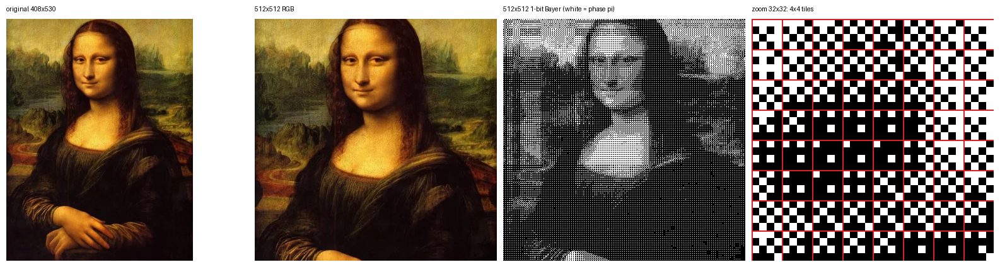
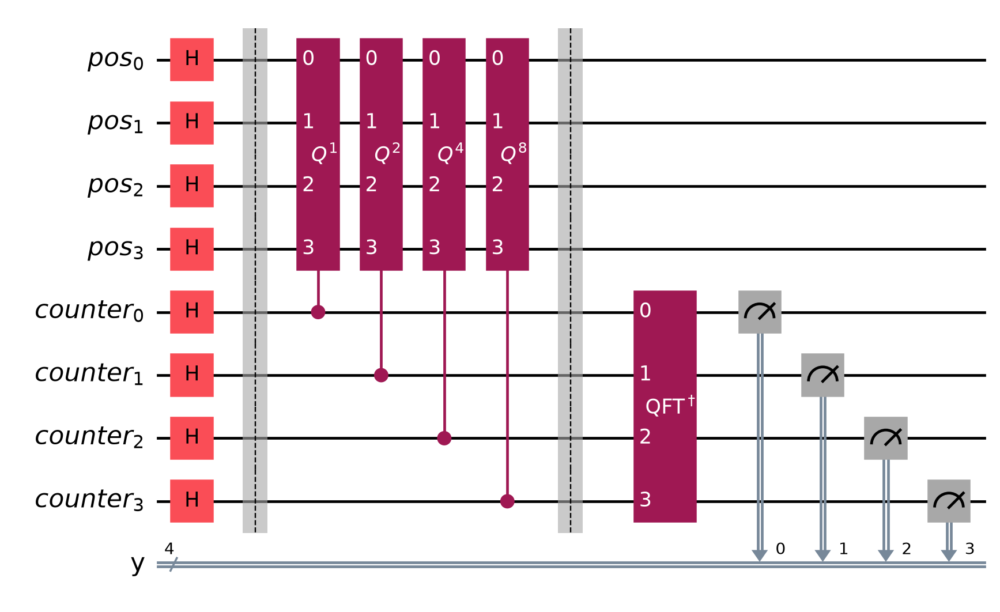
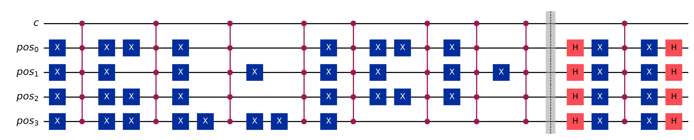
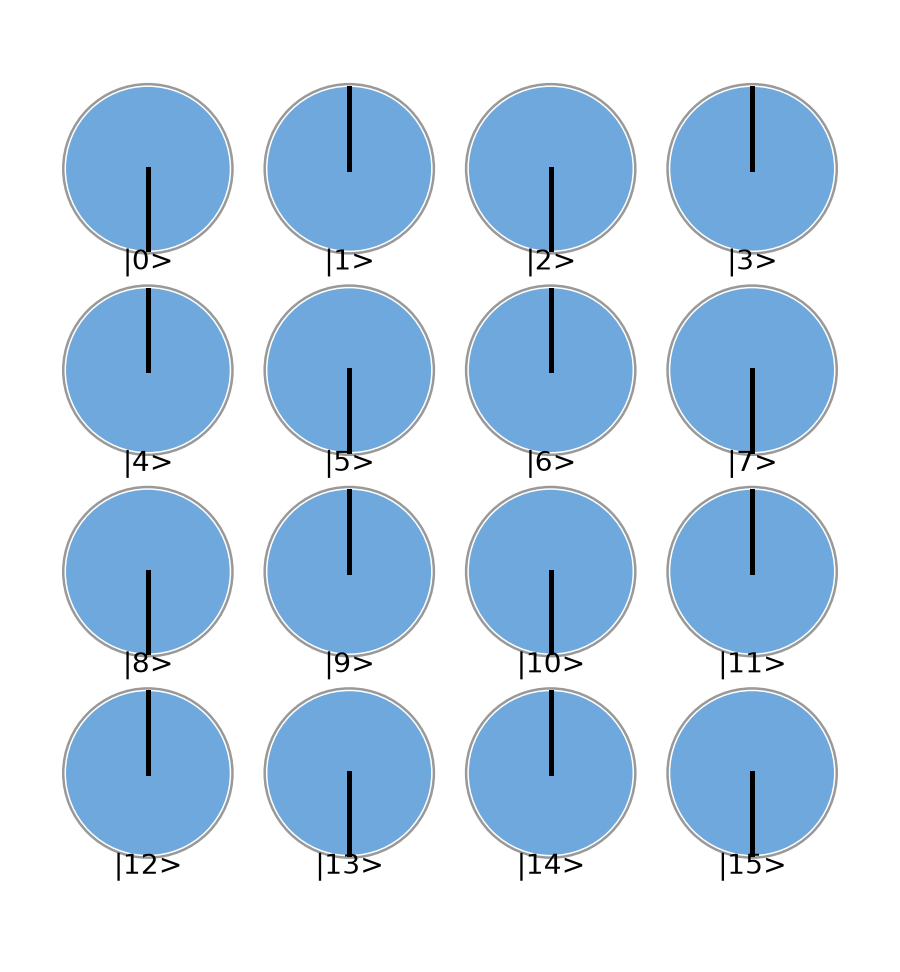
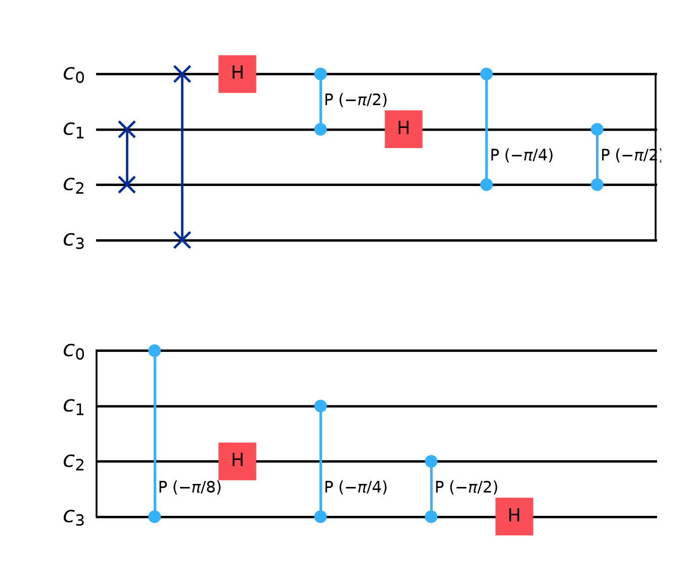
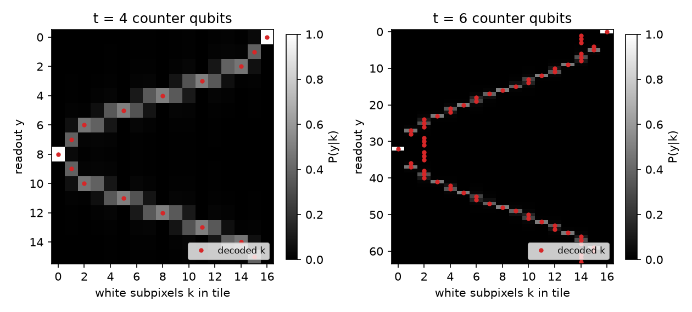
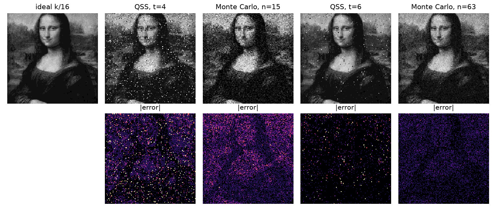
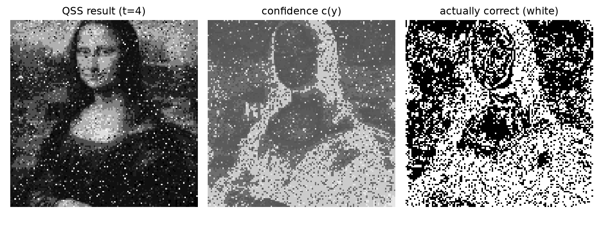
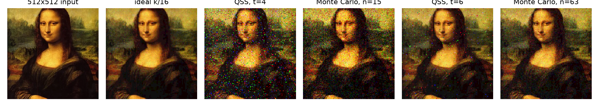

# Drawing the Mona Lisa with Quantum Supersampling

*Programming Quantum Computers, Chapter 11 — homework report*

## Abstract

We use the Quantum Supersampling (QSS) technique of Chapter 11 of *Programming Quantum Computers* to render a photograph of the Mona Lisa. The painting is resized to 512 × 512 subpixels and dithered to one bit. It is then split into 128 × 128 tiles of 4 × 4 subpixels. Each tile is drawn into the phases of a 4-qubit register by a phase oracle. Its brightness is then estimated with quantum sum estimation: controlled Grover iterations followed by an inverse QFT on a counter register. We build every circuit at the gate level in Qiskit, compute the QSS lookup table, and check the circuits against their matrix definitions. We compare QSS with Monte Carlo supersampling that uses the same number of oracle (shader) calls. With 4 counter qubits and one readout per tile, as in the book, QSS lowers the mean pixel error by 21% (0.0574 vs 0.0725). It also gives 1.78× as many exactly correct pixels (50.8% vs 28.6%). This reproduces the book's main observation: the average error is similar, but the noise has a different character. Colour output is produced with the book's bitplane method.

## 1. Background

**Supersampling.** A renderer computes many samples (rays) per output pixel and keeps only their average. Supersampling needs only the *sum* of many parallel evaluations, not the individual values. This is exactly the kind of quantity a QPU can estimate.

**Phase encoding (book §"Hands-on: Computing Phase-Encoded Images").** A Hadamard on every qubit of the `qx`, `qy` registers gives a uniform superposition over all pixel positions, a blank canvas. A pixel shader then "paints" white pixels by flipping their phase to π:

$$|\psi_f\rangle=\frac{1}{4}\sum_{x=0}^{15}(-1)^{f(x)}|x\rangle,\qquad f(x)=1 \text{ if subpixel }x\text{ is white}.$$

**Quantum sum estimation (book §"How QSS Works").** The shader is used as the *flip* step of amplitude amplification. Let the number of white subpixels be $k$ and define $\sin^2\theta = k/16$. One Grover iteration $Q$ then rotates by $2\theta$ in a two-dimensional subspace. A counter register in superposition runs a superposition of $0,1,\dots,2^t-1$ iterations, so the counter picks up a phase oscillation whose frequency depends on $\theta$. The inverse QFT reads out that frequency, and the **QSS lookup table** converts the readout $y$ back to $k$.

## 2. Image preparation (`src/prepare_image.py`)

| Step | Detail |
|---|---|
| Input | `shopping.webp`, 408 × 530 RGB |
| Square crop | 408 × 408, starting at y = 20 so the head is not cut |
| Resize | 512 × 512 (Lanczos) |
| 1-bit conversion | 4 × 4 Bayer ordered dither aligned with the tile grid (grey) and per channel (R, G, B bitplanes) |
| Tiling | 128 × 128 = 16 384 tiles of 4 × 4 subpixels |

We use Bayer dithering because each Bayer matrix exactly covers one tile. A tile of uniform brightness $v$ then contains $k\approx 16v$ white subpixels, so "number of white subpixels" is a faithful measure of brightness. The *ideal* output pixel is $k/16$, so QSS and Monte Carlo both estimate a known exact value.



*Figure 1 — original image, 512 × 512 crop, 1-bit Bayer image (white = phase π), and a 32 × 32 zoom with the 4 × 4 tile grid in red.*

## 3. Circuits

Each tile uses $4+t$ qubits: `pos[0..3]` holds the subpixel index $x = 4\,q_y + q_x$ (`pos0`, `pos1` = $q_x$; `pos2`, `pos3` = $q_y$), and `counter[0..t-1]` holds the counter. As in the book, the tile coordinates $(t_x,t_y)$ are classical loop variables.

### 3.1 Overall QSS circuit



*Figure 2 — QSS circuit for one tile with t = 4 counter qubits. Counter qubit $c_j$ controls $Q^{2^j}$, so the counter value selects the number of Grover iterations (book Example 11-4). The inverse QFT turns the counter phases into a readable frequency.*

### 3.2 One Grover iteration (gate level)

$$Q=\underbrace{H^{\otimes4}X^{\otimes4}\,(\text{MCZ})\,X^{\otimes4}H^{\otimes4}}_{\text{diffusion }=\,I-2|s\rangle\langle s|}\;\cdot\;\underbrace{\prod_{x:\,f(x)=1} X_{\bar x}\,(\text{MCZ})\,X_{\bar x}}_{\text{oracle }O_f}$$

The oracle flips the phase of each white subpixel $|x\rangle$ separately. It applies X to the qubits where $x$ has a 0, then a multi-controlled Z, then undoes the X gates. This is our "pixel shader". A photograph cannot be described by the arithmetic tricks of book §"Drawing Curves", so the shader is a lookup of the dithered bitmap.



*Figure 3 — controlled Grover iteration for the example tile at (64, 35) with k = 8 (a checkerboard). Only the multi-controlled Z gates need the extra counter control $c$. When $c=0$ the surrounding X and H gates cancel in pairs, so this is exactly controlled-$Q$. It mirrors the book's `mask_with_condition`. The uncontrolled version is `figures/circuit_grover_step.png`.*



*Figure 4 — circle notation of the same tile after $H^{\otimes4}$ and $O_f$: all 16 amplitudes have magnitude 1/4, and white subpixels have phase π.*

### 3.3 Inverse QFT



*Figure 5 — the 4-qubit inverse QFT used on the counter, made of SWAP, Hadamard, and controlled-phase gates.*

### 3.4 Phase convention

Our diffusion $I-2|s\rangle\langle s|$ (the book's `grover_iteration`) equals $-(2|s\rangle\langle s|-I)$. The eigenphases of $Q$ are therefore $\pi\pm2\theta$ instead of $\pm2\theta$, and the expected readout is

$$y \approx 2^t\left(\tfrac12 \pm \tfrac{\theta}{\pi}\right) \pmod{2^t}.$$

So $k=0$ is read near $y=2^{t-1}$ and $k=16$ near $y=0$, as in Figure 6. Because the lookup table is computed from the same circuit, the convention needs no special handling.

## 4. Lookup table, decoding and confidence

As in book Example 11-5, column $k$ of the lookup table is the readout distribution $P(y\mid k)$. It comes from the exact statevector of the circuit for a mask with $k$ white subpixels. A readout $y$ is decoded to $\hat k(y)=\arg\max_k P(y\mid k)$, which is the book's `qss_count_to_hits`, and the pixel becomes $\hat k/16$. The **confidence** of a pixel is the posterior $P(\hat k\mid y)=P(y\mid\hat k)/\sum_k P(y\mid k)$, assuming a uniform prior.



*Figure 6 — QSS lookup tables for 4 × 4 tiles with 4 (left) and 6 (right) counter qubits. Red dots show the decoded $k$. With $t=4$ there are only 16 readouts for 17 possible counts, and neighbouring columns overlap, as in book Fig. 11-14. With $t=6$ each $k$ has its own sharp peak, as in book Fig. 11-16.*

## 5. Implementation and verification (`src/qss.py`)

All circuits are built from Qiskit gates (H, X, multi-controlled Z, QFTGate) and simulated with `qiskit.quantum_info.Statevector` (Qiskit 2.6.1). We checked them three ways:

| Check | t = 4 | t = 6 |
|---|---|---|
| Gate-level $Q$ vs. matrix $(I-2|s\rangle\langle s|)\,\mathrm{diag}((-1)^{f})$ | 4.6 × 10⁻¹⁵ | 1.6 × 10⁻¹⁵ |
| $P(y)$ for randomly permuted masks vs. lookup table (all 17 $k$) | 9.3 × 10⁻¹⁵ | 4.0 × 10⁻¹⁴ |
| $P(y)$ for 40 real Mona Lisa tiles vs. lookup table | 1.9 × 10⁻¹⁴ | 6.1 × 10⁻¹⁴ |

The readout distribution depends only on $k$, not on where the white subpixels are, to machine precision. We therefore render the whole image by drawing one readout per tile from column $P(y\mid k)$. This is statistically identical to running and measuring each tile's circuit once, and it takes seconds instead of hours.

**Baseline.** Conventional Monte Carlo supersampling evaluates the shader at $n$ uniformly random subpixels of the tile and reports the white fraction. For a fair comparison $n$ equals the number of shader calls in the QSS circuit, $n = 2^t-1$ (15 for t = 4, 63 for t = 6). The estimate is rounded to the same 17 levels.

**Circuit size.** One tile circuit with $t=4$ is 8 qubits and about 1 600 CX gates after decomposition. With $t=6$ it is 10 qubits and about 6 800 CX gates.

## 6. Results

### 6.1 Greyscale



*Figure 7 — top: ideal output ($k/16$), QSS with one readout per tile, and Monte Carlo with the same number of shader calls. Bottom: absolute error.*

| Method | Shader calls / pixel | Mean abs. error | Exactly correct pixels |
|---|---|---|---|
| QSS, t = 4 (1 readout) | 15 | **0.0574** | **50.8%** |
| Monte Carlo, n = 15 | 15 | 0.0725 | 28.6% |
| QSS, t = 6 (1 readout) | 63 | **0.0115** | **91.1%** |
| Monte Carlo, n = 63 | 63 | 0.0321 | 54.6% |

At equal cost, QSS has 21% lower mean error and 1.78× as many exactly correct pixels for t = 4. The book reports about 33% and about 2×. With t = 6 the gap widens to 64% lower error and 1.67× as many correct pixels, because the counting error of QSS falls roughly as $1/N$ while Monte Carlo error falls only as $1/\sqrt N$.

### 6.2 Character of the noise

The error maps in Figure 7 show the effect the book describes. Monte Carlo error is a fine grain spread over **every** pixel, strongest where $k\approx 8$. QSS leaves most pixels **exactly** right and concentrates its error in a few isolated, high-contrast specks (maximum error 0.94). These are pixels where an unlucky readout fell on the "wrong branch" of the lookup table. Specks like these are easy to remove afterwards, for example with a median filter or by re-measuring only those pixels. The uniform Monte Carlo grain is not.

### 6.3 Confidence map



*Figure 8 — QSS result (t = 4), its confidence map, and the pixels that are actually correct. Pixels decoded to very dark or very bright values, read near y = 0 or y = 8, get high confidence. Mid-tones get low confidence. The correlation between confidence and correctness is 0.47.*

The confidence map is computed from the readouts alone, without knowing the true image. It could therefore guide a second pass that re-samples only the low-confidence pixels.

### 6.4 Colour



*Figure 9 — colour by bitplanes, following the book's "Adding Color". R, G and B are dithered separately, each plane is supersampled independently by QSS, and the planes are recombined. Each pixel has 17³ ≈ 4 900 possible colours, which is more than the book's 12-bit example.*

| Method (RGB, all channels) | Mean abs. error | Exactly correct channel values |
|---|---|---|
| QSS t = 4 / Monte Carlo n = 15 | 0.0502 / 0.0636 | 58.7% / 34.0% |
| QSS t = 6 / Monte Carlo n = 63 | 0.0096 / 0.0285 | 92.4% / 58.9% |

In colour, a QSS error appears as a single saturated red, green or blue speck. It comes from one wrong bitplane, while the other two channels stay exact.

## 7. Discussion

* **What the QPU contributes.** The QSS circuit never outputs an individual subpixel value. It estimates the *sum* over all 16 subpixels in superposition. As the book stresses, the gain here is not a speedup: the shader still runs $2^t-1$ times per pixel. The gain is that the probability of an *exact* answer increases with more samples, whereas the conventional estimate only *converges* toward it.
* **Ambiguity at t = 4.** A 4-qubit counter has 16 readouts for 17 possible values of $k$, and its peaks have a finite width. Neighbouring counts therefore overlap, especially for mid-tones. This is the source of both the speckle and the low confidence in the face and sky.
* **Cost of a photographic shader.** The book's shaders draw geometric shapes with a few arithmetic gates. A photograph has no compact formula, so our oracle needs one multi-controlled Z for each white subpixel. The resulting circuit has thousands of CX gates and is far beyond today's noisy hardware. Better oracle synthesis, such as an ESOP/Reed–Muller form or diagonal-gate synthesis, could reduce the cost.
* **Other image representations.** FRQI stores grey levels in a rotation angle, and NEQR stores them in a basis-state register. Both can hold a greyscale image without dithering. The book points out that encoding brightness in amplitudes would break the quantum sum estimation QSS relies on, which is why we keep a one-bit phase encoding and handle tone with dithering and bitplanes.
* **Limitations.** Everything here is a noiseless statevector simulation, and the bitmap is prepared classically. Per-tile readouts are sampled from the lookup table, which we verified to be exact. These results show how the algorithm behaves, not a hardware advantage.

## 8. Conclusion

We used the full QSS pipeline of Chapter 11 to draw the Mona Lisa. The pipeline consists of a phase-encoded canvas, a pixel-shader oracle, controlled Grover iterations, an inverse QFT, a lookup table, confidence maps and colour bitplanes. At equal sampling cost, QSS gives a lower mean error than Monte Carlo and nearly twice as many exactly correct pixels. Its noise takes the form of rare, isolated specks instead of grain everywhere. This reproduces the book's central point: a QPU can be useful by *redistributing* noise, even without being faster.

## Reproducing

```bash
python3 -m venv .venv && .venv/bin/pip install qiskit numpy matplotlib pillow pylatexenc
python3 src/prepare_image.py          # data/ and figures/step1_overview.png
.venv/bin/python src/qss.py           # results/, figures/, results/metrics.json (~80 s)
```

## References

1. E. R. Johnston, N. Harrigan, M. Gimeno-Segovia, *Programming Quantum Computers*, O'Reilly, 2019, Ch. 11 "Quantum Supersampling" (and Ch. 5–7 for arithmetic, amplitude amplification and QFT).
2. P. Q. Le, F. Dong, K. Hirota, "A flexible representation of quantum images (FRQI)", *Quantum Inf. Process.* 10, 2011.
3. Y. Zhang et al., "NEQR: a novel enhanced quantum representation of digital images", *Quantum Inf. Process.* 12, 2013.
4. pongsakornsaks-KU/quantum-programming, `projects/quantum-supersampling` (GitHub), consulted as a reference for the overall pipeline. Our implementation is independent: it uses gate-level oracles and diffusion, the book's 4-counter-qubit setting with a single readout, an equal-cost Monte Carlo comparison, confidence maps and colour bitplanes.
